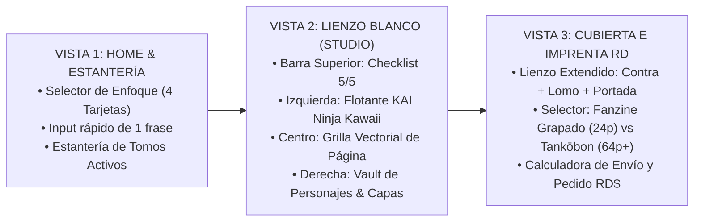

# SISTEMA DE DISEÑO UX/UI: ESTÉTICA "TŌKON PAPER" & FLUJO DE DOPAMINA RÁPIDA

## 1. Corrección Crítica de Experiencia de Usuario (UX)

* **[Seguro] Eliminar el "Muro de Preguntas" al inicio:** En lugar de pedirle al usuario 5 definiciones teóricas antes de ver un solo trazo, aplicamos el **Flujo de Compromiso Progresivo (Progressive Disclosure)**:
  1. **Entrada (15 segundos):** El usuario elige **Para quién es el manga** (Tarjeta visual: *Acción/Shonen*, *Historia/Cultura*, *Romance/Drama* o *Regalo Épico para alguien*) y escribe **1 sola frase** con su idea.
  2. **Recompensa Inmediata (60 segundos):** KAI (con su avatar Ninja Kawaii animado) genera frente a sus ojos la **Carta de Personaje Principal (*Character Sheet*) + la Viñeta #1**.
  3. **Retención (El Checklist de 5 Hitos como Barra de Progreso Superior):** Al generar la primera viñeta, la barra superior marca automáticamente los **Hitos 1 y 2 como completados (40%)**, activando el efecto psicológico de *meta iniciada* (Efecto Zeigarnik) para que el usuario quiera completar los 3 hitos restantes.

---

## 2. Arquitectura de Pantallas (Las 3 Vistas de la Aplicación)

---

## 3. Tokens del Sistema Visual ("Estética Tōkon Limpia")

| Elemento | Valor / Hex | Regla de Uso en Interfaz |
| :--- | :--- | :--- |
| **Fondo Principal (Lienzo)** | `#FAF8F5` (Papel Manga Crema Suave) | Evita la fatiga visual del blanco puro (`#FFFFFF`) y simula el papel ahuesado real de imprenta. |
| **Superficies / Tarjetas** | `#FFFFFF` con trama sutil `radial-gradient` | Tarjetas limpias con borde sólido de tinta negra (`2px solid #09090B`) y sombra dura desplazada (`4px 4px 0px #09090B`). |
| **Tinta Principal (Bordes y Texto)** | `#09090B` (Negro Tinta Sumi) | Tipografía de alta legibilidad (*Inter* / *Plus Jakarta Sans* para UI; *CC Wild Words* / *Bangers* para globos y SFX). |
| **Acento Primario (Acción)** | `#E11D48` (Rojo Carmesí Sello Japonés) | Botones principales ("Generar Viñeta", "Imprimir Tomo") y sello de hito completado. |
| **Acento Secundario (KAI / IA)** | `#FACC15` (Amarillo Cyber) | Indicadores de actividad del asistente KAI, resaltado de sugerencias y etiquetas de "Modo Sensei". |

---

## 4. Especificación del Componente: Avatar "KAI Ninja Kawaii"

* **[Probable]** Para que KAI no ocupe media pantalla con un chat invasivo y deje respirar al lienzo blanco:
  * **Posición:** Dock flotante compacto en la esquina inferior izquierda (o panel lateral colapsable de `320px`).
  * **Anatomía Visual (SVG Reactivo):** Cabeza redonda minimalista con máscara ninja, cinta frontal con símbolo Taíno/Manga y ojos expresivos que cambian según el estado del sistema:
    1. `idle` (Ojos parpadeando suaves): Esperando instrucción.
    2. `thinking` (Ojos de fuego / cinta ondeando): Generando guion o viñeta.
    3. `tip` (Bombilla / guiño): Sugiriendo las 3 opciones (A, B, C) cuando el usuario se detiene.
    4. `print_check` (Lentes de editor): Validando que el texto no pase de 22 palabras y que el sangrado de 3mm esté limpio.
