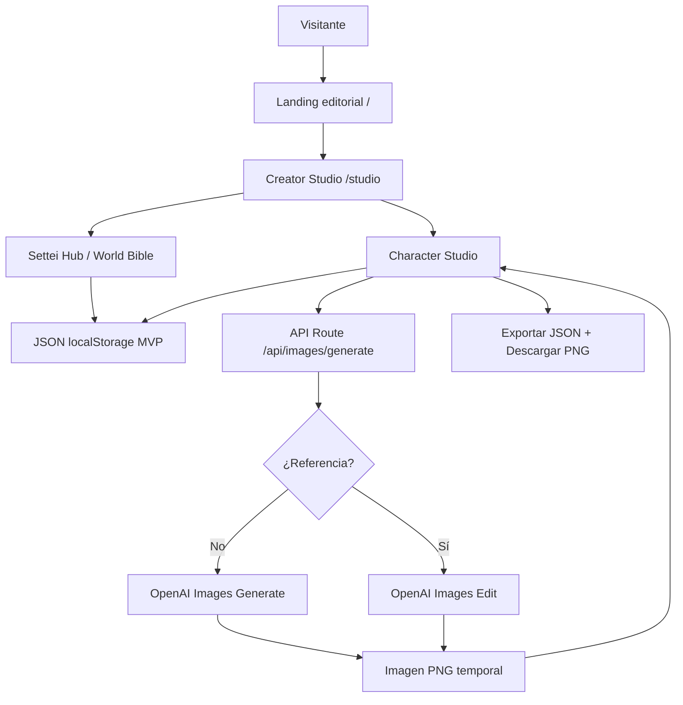

# Arquitectura MANGAI — Estado v0.4

**Separación crítica:** la landing está preservada como HTML/CSS/JS estático editable por separado. Next.js sirve esa landing en la raíz mediante una regla `beforeFiles`; el Studio es una aplicación React moderna.

**Módulos futuros:** KAI conversacional (Responses API con memoria estructurada), repositorio de proyectos autenticado, almacenamiento de referencias versionadas, editor de viñetas Nemu/Genkō y Tankōbon para PDF impresión y KDP. No están implementados aún.

**Canon/consistencia:** el motor compone el prompt con los datos del personaje y del universo. Para preservar la identidad, se debe trabajar con imagen de referencia aprobada y revisar manualmente las generaciones. El bloqueo de canon evita cambios accidentales en fichas mientras está activo. No es entrenamiento propio de modelos ni control determinista de píxeles.

**Deuda técnica planeada:** migrar la landing estática a componentes React sin alterar su diseño; sustituir localStorage por PostgreSQL/Supabase; store de medios en bucket privado; roles y permisos; estados de job; costos/cuotas; tests e2e; conversión vector/raster y composición editorial; CDN imágenes con consentimiento del usuario.

## Sprint 1 (P0) — Estabilización Visual, `lucide-react`, Estado Granular y Deep-Linking

- **Iconografía SVG (`lucide-react`):** Se eliminaron las ligaduras de `Material Symbols Outlined` y glifos Unicode propensos a renderizarse como `▯` (`✦`, `✳`, `✕`) en `/studio` y `/`, sustituyéndolos por componentes SVG de `lucide-react` (`strokeWidth={1.75}`, `gf-icon-shrink`) e iconos SVG inline en la landing estática.
- **Tema *Genkō Paper & Sumi Ink* + Modo Oscuro:** `/studio` usa por defecto la estética editorial clara (`#ECEAE4` mesa de trabajo, `#FFFFFF` paneles con bordes `#E2E0D8`, `#FAF8F5` hoja Genkō 135kg con guías cian `#00AEEF`, tinta `#111111` y acento `#4F46E5`) con interruptor persistente (`Sun`/`Moon`) hacia el modo oscuro (`#121316` / `#1A1C20`).
- **Estado de carga aislado (`GeneratingState`):** Definido en `app/studio/types.ts` y gestionado en `app/studio/page.tsx` mediante `setTaskLoading`, `setPageLoading` y `setCharacterLoading`:
  - `cover: boolean` aísla la generación 16:9 de `Portada Tankōbon`.
  - `bundle: boolean` aísla el empaquetado ZIP (`Exportar Paquete ZIP`).
  - `pages: Record<string, boolean>` aísla cada página interior por `page.id`.
  - `characters: Record<string, boolean>` aísla cada ficha de personaje por `character.id`.
- **Navegación bidireccional y deep-linking (`/studio?tab=`):** La sección `04 / 05` de la landing enlaza directamente mediante `/studio?tab=<slug>` (`project`, `characters`, `cover`, `pages`, además de alias `lore`, `panels`, `print`), leído al montar en `app/studio/page.tsx` y sincronizado al cambiar de pestaña; el encabezado `MANGAI STUDIO` permite regresar a `/` en un clic.
- **Modal `INSPECCIONAR TOMO ↗` (`03 / 05`):** El contenedor `.modal-cover-frame` fuerza proporción Tankōbon `2:3` con `object-fit: cover`, borde sutil y fallback visual tipográfico ante errores de carga.

## Sprint 2 (P1) — Persistencia Supabase, Copiloto KAI Sensei y Motor Koma-wari

- **Esquema SQL Supabase (`supabase/migrations/001_mangai_studio_schema.sql`):** Define 4 enums (`settei_entity_type`, `koma_state`, `reading_dir`, `paper_type`) y 5 tablas normalizadas (`profiles`, `projects`, `settei_entities`, `pages`, `komas`) con Row Level Security (RLS) por `auth.uid()`, índices de consulta y triggers `updated_at`.
- **Repositorio dual (`lib/supabase/client.ts` + `lib/storage/studioRepository.ts`):** Sincroniza con Supabase si hay credenciales públicas y sesión activa; en modo invitado/demo persiste automáticamente en `localStorage` con indicador visible en la barra superior (`Local / Demo` vs `Supabase Sync`).
- **Endpoint `POST /api/kai/script` + Zod (`lib/kai/schema.ts`):** Valida entrada y salida dual estricta (`KaiDualOutputSchema`: `reply` + `script_pages[]`). Usa Gemini/OpenAI server-side si existen llaves o degrada con cabecera `X-KAI-Mode: fallback` claramente etiquetada como plantilla editorial en `KaiCopilotDrawer.tsx`.
- **Settei v2 y Motor Koma-wari (`CharacterLibrary.tsx`, `PageEditor.tsx`, `page.tsx`):**
  - Entidades Settei con pestañas (`Personajes`, `Objetos (Props)`, `Escenarios y Lore`), `@tag_handle` único, chips de **Anclas Visuales** y `Seed Bloqueado`.
  - 4 presets geométricos (`3_panel_dramatic`, `4_panel_classic`, `5_panel_action` con corte diagonal central, `splash_spread`), recorte CSS `clip-path` + bordes vectoriales SVG, selección interactiva de viñeta (`#4F46E5`), máquina de estados (`VACIO → NEMU → PEN_IRE → TONE_FX → SHIAGE → LOCKED`) y generación aislada por `komaId` (`generating.komas[komaId]`).

## Sprint 3 — Globos Fukidashi (`L5`), Pila Estricta `L0–L6`, Presets de Imprenta y Aplanado Pre-Prensa

- **Pila de 7 Capas (`L0`–`L6`) con Z-Index fijo (`10`–`70`):** `L6_guides` (`70`, no imprimible), `L5_balloons` (`60`), `L4_sfx` (`50`), `L3_borders_fx` (`40`), `L2_ink` (`30`), `L1_tones` (`20`, opacidad ajustable) y `L0_nemu` (`10`, no imprimible, opacidad default `40%`). Controladas desde el panel `L6 → L0` en el Inspector Derecho.
- **Globos Vectoriales (`components/studio/FukidashiLayer.tsx`) y SFX (`KakimojiLayer.tsx`):** 6 estilos SVG (`normal`, `shout`, `whisper`, `thought`, `narrator`, `system`), arrastre por puntero, cola orientable, edición inline por doble clic, alerta visual *Naiwaku* y botón `Marcar Viñeta Lista (SHIAGE → LOCKED)`.
- **Formatos y Portada (`lib/print/presets.ts` + `lib/print/ean13.ts`):** Presets `tankobon_b6`, `b4_canva_pro` (`2150 × 3035 px` + `3.5 mm` bleed) y `kdp_6x9`; ISBN-13 editable con código de barras EAN-13 SVG puro opcional y tipografía en vivo sobre el *Full Wrap*.
- **Exportador Pre-Prensa (`lib/export/buildPrintBundle.ts` + `PreflightModal.tsx`):** Aplanado estricto `L1 → L5` (excluye automáticamente `L0` y `L6`), Semáforo Pre-Flight de 4 verificaciones, `README_IMPRENTA.txt` y descarga con nombre dinámico `${slug}_${trimFormat}_PRINT_BUNDLE.zip`.
