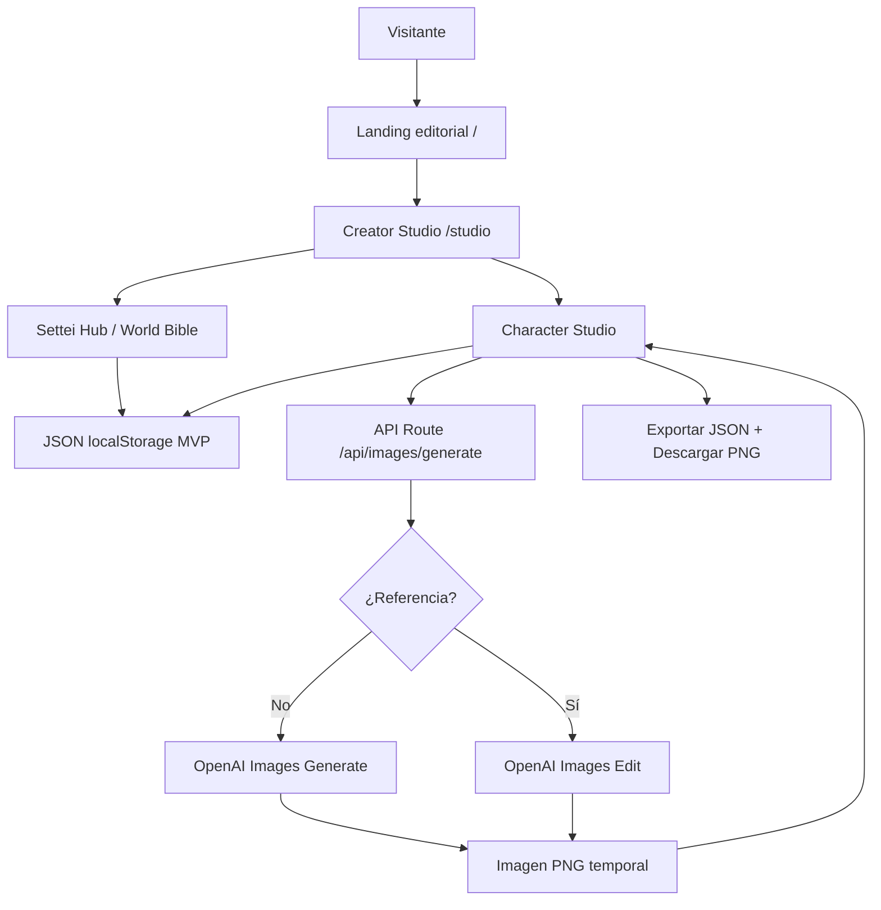

# Arquitectura MANGAI — Estado v0.4

**Separación crítica:** la landing está preservada como HTML/CSS/JS estático editable por separado. Next.js sirve esa landing en la raíz mediante una regla `beforeFiles`; el Studio es una aplicación React moderna.

**Módulos futuros:** KAI conversacional (Responses API con memoria estructurada), repositorio de proyectos autenticado, almacenamiento de referencias versionadas, editor de viñetas Nemu/Genkō y Tankōbon para PDF impresión y KDP. No están implementados aún.

**Canon/consistencia:** el motor compone el prompt con los datos del personaje y del universo. Para preservar la identidad, se debe trabajar con imagen de referencia aprobada y revisar manualmente las generaciones. El bloqueo de canon evita cambios accidentales en fichas mientras está activo. No es entrenamiento propio de modelos ni control determinista de píxeles.

**Deuda técnica planeada:** migrar la landing estática a componentes React sin alterar su diseño; sustituir localStorage por PostgreSQL/Supabase; store de medios en bucket privado; roles y permisos; estados de job; costos/cuotas; tests e2e; conversión vector/raster y composición editorial; CDN imágenes con consentimiento del usuario.

## Sprint 1 (P0) — Estabilización Visual, `lucide-react`, Estado Granular y Deep-Linking

- **Iconografía SVG (`lucide-react`):** Se eliminaron las ligaduras de `Material Symbols Outlined` y glifos Unicode propensos a renderizarse como `▯` (`✦`, `✳`, `✕`) en `/studio` y `/`, sustituyéndolos por componentes SVG de `lucide-react` (`strokeWidth={1.75}`, `gf-icon-shrink`) e iconos SVG inline en la landing estática.
- **Tema *Genkō Paper & Sumi Ink* + Modo Oscuro:** `/studio` usa por defecto la estética editorial clara (`#ECEAE4` mesa de trabajo, `#FFFFFF` paneles con bordes `#E2E0D8`, `#FAF8F5` hoja Genkō 135kg con guías cian `#00AEEF`, tinta `#111111` y acento `#4F46E5`) con interruptor persistente (`Sun`/`Moon`) hacia el modo oscuro (`#121316` / `#1A1C20`).
- **Estado de carga aislado (`GeneratingState`):** Definido en `app/studio/types.ts` y gestionado en `app/studio/page.tsx` mediante `setTaskLoading`, `setPageLoading` y `setCharacterLoading`:
  - `cover: boolean` aísla la generación 16:9 de `Portada Tankōbon`.
  - `bundle: boolean` aísla el empaquetado ZIP (`Exportar Paquete ZIP`).
  - `pages: Record<string, boolean>` aísla cada página interior por `page.id`.
  - `characters: Record<string, boolean>` aísla cada ficha de personaje por `character.id`.
- **Navegación bidireccional y deep-linking (`/studio?tab=`):** La sección `04 / 05` de la landing enlaza directamente mediante `/studio?tab=<slug>` (`project`, `characters`, `cover`, `pages`, además de alias `lore`, `panels`, `print`), leído al montar en `app/studio/page.tsx` y sincronizado al cambiar de pestaña; el encabezado `MANGAI STUDIO` permite regresar a `/` en un clic.
- **Modal `INSPECCIONAR TOMO ↗` (`03 / 05`):** El contenedor `.modal-cover-frame` fuerza proporción Tankōbon `2:3` con `object-fit: cover`, borde sutil y fallback visual tipográfico ante errores de carga.
