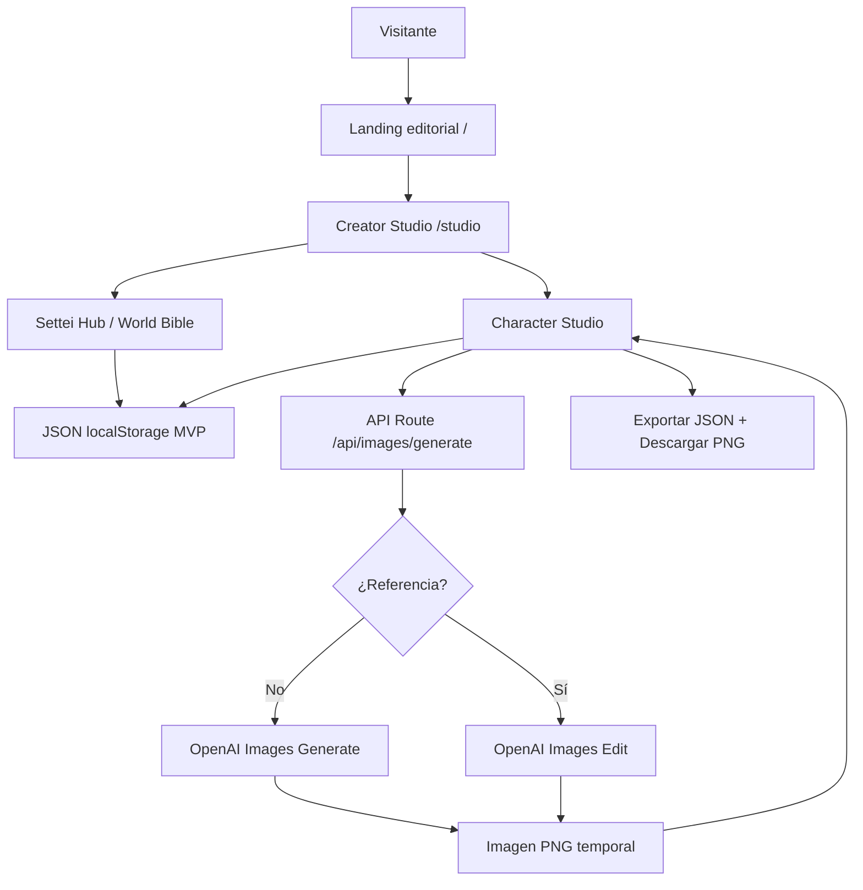

# Arquitectura MANGAI — Estado v0.4

**Separación crítica:** la landing está preservada como HTML/CSS/JS estático editable por separado. Next.js sirve esa landing en la raíz mediante una regla `beforeFiles`; el Studio es una aplicación React moderna.

**Módulos futuros:** KAI conversacional (Responses API con memoria estructurada), repositorio de proyectos autenticado, almacenamiento de referencias versionadas, editor de viñetas Nemu/Genkō y Tankōbon para PDF impresión y KDP. No están implementados aún.

**Canon/consistencia:** el motor compone el prompt con los datos del personaje y del universo. Para preservar la identidad, se debe trabajar con imagen de referencia aprobada y revisar manualmente las generaciones. El bloqueo de canon evita cambios accidentales en fichas mientras está activo. No es entrenamiento propio de modelos ni control determinista de píxeles.

**Deuda técnica planeada:** migrar la landing estática a componentes React sin alterar su diseño; sustituir localStorage por PostgreSQL/Supabase; store de medios en bucket privado; roles y permisos; estados de job; costos/cuotas; tests e2e; conversión vector/raster y composición editorial; CDN imágenes con consentimiento del usuario.
